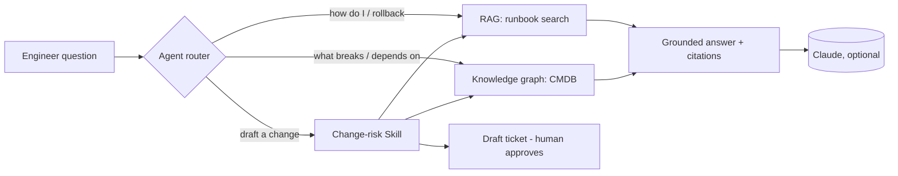

# Ops Knowledge Copilot (POC)

An AI assistant that helps infrastructure engineers plan changes safely. It answers runbook questions with
citations, tells you what breaks if a server goes down, and drafts change tickets with a risk rating.
It says "I don't know" instead of guessing.

It's a proof of concept for taking frontier AI concepts (**RAG, knowledge graphs, agents, Claude Skills**)
from idea to a measurable POC gate. The product requirements are in [`docs/requirements.md`](docs/requirements.md),
written as SAFe artifacts: an epic hypothesis, features, stories and staged gates.

> All systems, runbooks and data here are fictional.

## What it does

```
$ python -m copilot "Draft a change ticket to patch batch-01 at 01:15"

CHANGE TICKET (DRAFT - requires human approval)
Target: batch-01
Planned window: 01:15
Risk rating: High
Why: Tier 1 business service impacted: merchant-payouts; Planned window conflicts with a blackout rule

Impacted services:
- batch-settlement (Tier 1, application)
- merchant-payouts (Tier 1, business service)
...
Blackout check: CONFLICT: window 01:15 falls in the 00:30-04:00 CT blackout [source: batch-settlement-job.md#procedure]
```

The blackout rule isn't hard-coded. The agent finds it in a runbook, and the impacted services come from the
dependency graph. Neither source alone would catch this conflict.

```
$ python -m copilot "What breaks if db-legacy-09 goes down?"
I don't know: db-legacy-09 is not in the dependency graph or any runbook. Check the name or ask the
system owner. I won't guess its dependencies.
```

## How it works



| Piece | File | Production equivalent |
|---|---|---|
| RAG retrieval (BM25 over runbook sections) | `copilot/retriever.py` | Vector DB + embeddings (pgvector, OpenSearch, Bedrock KB) |
| Knowledge graph | `copilot/graph.py`, `data/graph.json` | Neo4j / Neptune fed from the CMDB |
| Agent router and guardrails | `copilot/agent.py` | Agent framework (Claude Agent SDK, Google ADK) |
| Skill | `skills/change-risk-assessment/SKILL.md` | Same file, versioned and owned by Change Management |
| LLM | `copilot/llm.py` | Claude via API / Bedrock / Vertex |

## Evals: the POC gate

Quality is measured, not guessed. `evals/golden_set.jsonl` holds 34 test cases: runbook questions, dependency
questions, change tickets, and questions it **must refuse**. `evals/run_evals.py` scores them against the POC exit
criteria, and GitHub Actions runs it on every push. A missed gate fails the build.

| Metric | Score | POC gate |
|---|---|---|
| Runbook source found in top 3 | 100% | ≥ 80% |
| Runbook section correct (top 1) | 92% | ≥ 80% |
| Dependency recall / precision | 100% / 100% | ≥ 90% |
| Change ticket risk rating correct | 100% | ≥ 80% |
| Blackout conflicts detected | 100% | 100% |
| Refuses when it should | 100% | ≥ 90% |
| No false refusals | 100% | ≥ 90% |
| Answers with a citation | 100% | 100% |

Full scorecard: [`evals/report.md`](evals/report.md).

**Known failure (R02):** "How do I rotate the auth certificate?" returns the *Purpose* section above *Procedure*.
Keyword search can't tell what a "how do I" question is asking for. This is the main reason the MVP moves to
vector search. The case stays in the golden set so the fix can be measured.

## Run it

Requires Python 3.10+. No packages to install.

```bash
python -m copilot                      # interactive
python -m copilot "What breaks if kafka-prod-02 goes down?"
python -m unittest discover tests      # guardrail tests
python evals/run_evals.py              # eval gate
```

**With Claude:** set `ANTHROPIC_API_KEY` and answers are written by Claude, grounded in the retrieved runbook text.
The change-risk Skill is loaded as its instructions. Override the model with `OPS_COPILOT_MODEL`. Without a key, it runs
in offline mode and returns the cited runbook text itself. Offline mode is also the fallback if the API is down.

## Roadmap

| Stage | Scope | Exit criteria |
|---|---|---|
| **POC (done)** | 5 runbooks, 23-node graph, 1 Skill | Gates above, enforced in CI |
| MVP | Real runbooks and CMDB feed, vector search, Claude answers, 3 pilot teams | ≥ 85% accuracy, < 5% unsupported claims, p95 < 5 s, security review |
| Production | SSO, audit log, monitoring, all infra teams | Model risk approval, SLOs, cost per query under budget |

## Repo layout

```
copilot/            agent, retriever, graph, optional Claude client, CLI
skills/             change-risk-assessment Skill (SKILL.md)
data/               fictional runbooks and CMDB dependency graph
evals/              golden set, eval harness, latest report
tests/              guardrail unit tests
docs/               product requirements (SAFe epic, features, stories, gates)
.github/workflows/  CI: tests + eval gate on every push
```
